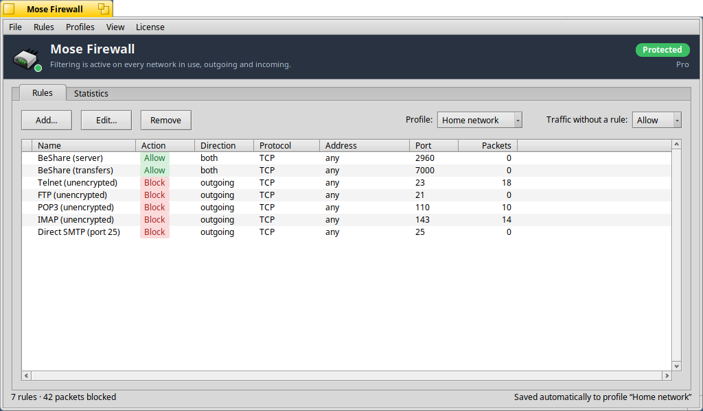
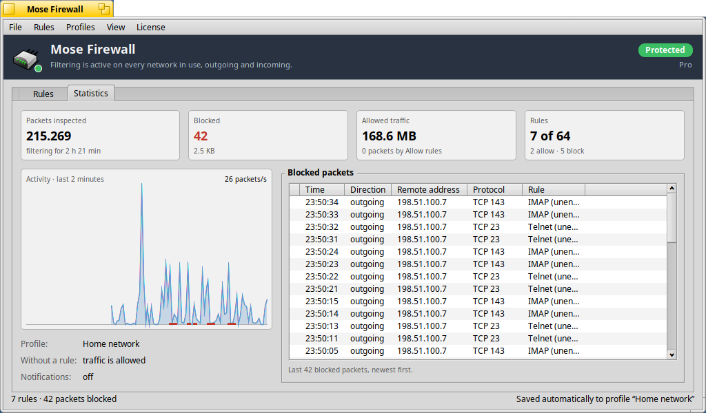

# Mose Firewall

Un firewall per [Haiku](https://www.haiku-os.org), con una finestra
nativa, un'icona nel Deskbar e un comando per il Terminale.

Mose Firewall filtra il traffico di rete del tuo computer Haiku, in
uscita e in entrata, IPv4 e IPv6. Funziona come add-on del kernel, quindi
vale per tutte le applicazioni, e non smette mai di filtrare per motivi
di licenza.

*[Read in English](README.md)*

## Funzioni

- **Regole** per indirizzo remoto (un computer o una rete), porta,
  protocollo (TCP, UDP, ICMP, ICMPv6 o qualunque), direzione e versione
  IP, con un nome a tua scelta. I servizi più comuni (web, DNS, posta,
  SSH…) compilano i campi per te.
- **Cosa fare del traffico senza regola**: consentirlo, oppure bloccarlo
  e lasciar passare solo quello che le regole consentono.
- **Profili** per i posti in cui usi il computer, cinque già pronti:

  | Profilo            | Senza regola | Cosa fa |
  | ------------------ | ------------ | ------- |
  | Nessun filtro      | consenti     | nessuna regola |
  | Rete domestica     | consenti     | consente BeShare; blocca in uscita Telnet, FTP, POP3, IMAP non cifrati e SMTP sulla porta 25 |
  | Rete aziendale     | consenti     | blocca accessi non cifrati, SMTP sulla porta 25, BeShare, BitTorrent, eMule, streaming RTMP |
  | Rete pubblica      | consenti     | blocca BeShare, FTP/POP3/IMAP non cifrati, condivisione file (SMB, NetBIOS) e scoperta locale (LLMNR, mDNS, SSDP) |
  | Massima protezione | blocca       | consente solo DHCP, DNS, ora di rete, ICMP, web (HTTP/HTTPS) e posta cifrata |

- **Uno stato di protezione affidabile**: la finestra e l'icona nel
  Deskbar diventano verdi solo quando ogni rete attiva è davvero
  filtrata, arancioni quando qualcosa non lo è, rosse quando il filtro
  non risponde.
- **Statistiche**: pacchetti analizzati e bloccati, traffico consentito,
  l'attività degli ultimi due minuti e l'elenco dei pacchetti bloccati,
  con ora, indirizzo, porta e regola che li ha fermati.
- **Icona nel Deskbar** con le luci del router che seguono il traffico
  (diventano rosse quando un pacchetto viene bloccato) e un menu per
  mettere in pausa il filtro, cambiare profilo o vedere gli ultimi
  pacchetti bloccati.
- **Finestra Connessioni**: le connessioni TCP del computer, con il
  programma che le ha aperte; blocchi un indirizzo o una porta con un
  clic.
- **Riga di comando**: `mose_firewall_ctl` fa tutto quello che fa la
  finestra, per script e amministrazione da remoto.
- Tema chiaro e scuro, schermi piccoli (1024×600) e otto lingue:
  italiano, inglese, tedesco, francese, spagnolo, giapponese, cinese,
  ucraino.

## Gratis, con registrazione

Mose Firewall è **gratuito**. Ogni installazione parte con una prova di
10 giorni con tutte le funzioni; per mantenerle **registrati
gratuitamente**:

1. scegli **Licenza → Ottieni Pro…** nella finestra;
2. inserisci il tuo indirizzo email nella pagina che Mose apre nel
   browser;
3. incolla in Mose la chiave di attivazione che ricevi.

La chiave è legata al tuo computer (al massimo due computer per email) e
viene verificata sul computer, senza collegarsi a nessun server mentre
usi Mose.

Con la registrazione hai Mose Firewall **Pro**: fino a 64 regole,
profili illimitati, la finestra Connessioni, le notifiche, l'elenco dei
pacchetti bloccati e il menu completo del Deskbar. Senza registrazione
Mose continua a filtrare nella versione **Base**: fino a 10 regole e un
profilo tuo oltre a quelli già pronti. Il filtro non viene mai
disattivato per motivi di licenza.

## Installazione

1. Scarica il pacchetto per il tuo sistema da
   [Releases](../../releases):

   | Haiku                        | Pacchetto |
   | ---------------------------- | --------- |
   | 64 bit (x86_64)              | `mose_firewall-…-x86_64.hpkg` |
   | 32 bit (ibrido x86_gcc2)     | `mose_firewall-…-x86_gcc2.hpkg` |
   | ARM                          | `mose_firewall-…-arm.hpkg` |

2. Copialo in `/boot/home/config/packages`. Non installarlo tra i
   pacchetti di sistema: Mose parte dalla tua cartella home.
3. Apri **Mose Firewall** dal menu Applicazioni del Deskbar.

Il filtro parte a ogni avvio con il profilo che hai scelto. Per
rimuovere Mose Firewall, cancella il pacchetto da
`/boot/home/config/packages`.

Requisiti: una nightly di Haiku recente. Il pacchetto indica la versione
di Haiku che gli serve; un sistema più vecchio lo rifiuta invece di
caricare un add-on del kernel compilato per un'altra versione.

## Da sapere

- Il filtro è **senza stato**: le regole guardano indirizzo e porta
  dell'altro lato, non le connessioni. Per rifiutare il traffico in
  entrata non richiesto, blocca il traffico senza regola («Massima
  protezione») e consenti i servizi che usi.
- Il traffico fra programmi dello stesso computer (localhost) non viene
  filtrato.
- Su Haiku a 32 bit l'icona nel Deskbar non è disponibile: lì il Deskbar
  non può caricare programmi compilati con il compilatore moderno. La
  finestra e la riga di comando funzionano come sugli altri sistemi.

## Licenza

Mose Firewall è software proprietario, gratuito, con registrazione
gratuita obbligatoria per l'uso completo. Il codice sorgente non è
pubblicato. Vedi [LICENSE](LICENSE) e
[THIRD-PARTY-NOTICES.md](THIRD-PARTY-NOTICES.md).

© 2025–2026 Andrea Bernardi.
