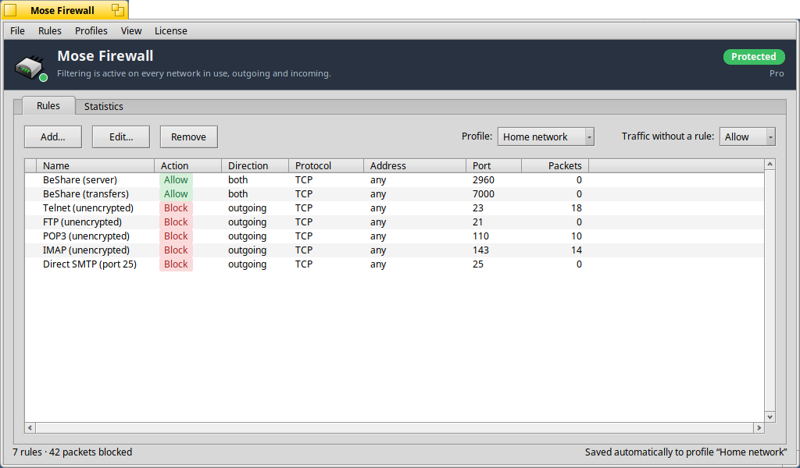
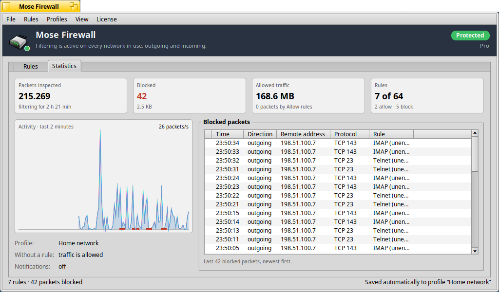

# Mose Firewall

A packet filter for [Haiku](https://www.haiku-os.org), with a native
window, a Deskbar icon and a command line tool.

Mose Firewall filters the network traffic of your Haiku computer,
outgoing and incoming, IPv4 and IPv6. It runs as a kernel add-on, so it
works for every application, and it never stops filtering because of the
licence.

*[Leggi in italiano](README.it.md)*

## Features

- **Rules** by remote address (single computer or network), port,
  protocol (TCP, UDP, ICMP, ICMPv6 or any), direction and IP version,
  with a name you choose. Ready-made services (web, DNS, mail, SSH, …)
  fill the fields for you.
- **What happens to traffic without a rule**: allow it, or block it and
  let through only what your rules allow.
- **Profiles** for the places you use your computer, five of them ready:

  | Profile            | Without a rule | What it does |
  | ------------------ | -------------- | ------------ |
  | No filtering       | allow          | no rules |
  | Home network       | allow          | allows BeShare; blocks outgoing clear-text Telnet, FTP, POP3, IMAP and SMTP on port 25 |
  | Work network       | allow          | blocks clear-text logins, SMTP on port 25, BeShare, BitTorrent, eMule, RTMP streaming |
  | Public network     | allow          | blocks BeShare, clear-text FTP/POP3/IMAP, file sharing (SMB, NetBIOS) and local discovery (LLMNR, mDNS, SSDP) |
  | Maximum protection | block          | allows only DHCP, DNS, network time, ICMP, web (HTTP/HTTPS) and encrypted mail |

- **Protection status you can trust**: the window and the Deskbar icon
  turn green only when every active network is really filtered, orange
  when something is not, red when the filter does not answer.
- **Statistics**: packets inspected and blocked, allowed traffic, the
  activity of the last two minutes, and the list of blocked packets
  with time, address, port and the rule that blocked them.
- **Deskbar icon** with the router lights following the traffic (they
  turn red when a packet is blocked), and a menu to pause the filter,
  switch profile or see the last blocked packets.
- **Connections window**: the TCP connections of your computer, with
  the program that opened them; block an address or a port in one click.
- **Command line**: `mose_firewall_ctl` does everything the window does,
  for scripts and remote administration.
- Light and dark themes, small screens (1024×600), and eight languages:
  English, Italian, German, French, Spanish, Japanese, Chinese,
  Ukrainian.

## Free, with registration

Mose Firewall is **free**. Every installation starts with a 10-day
trial with all the features; to keep them, **register for free**:

1. choose **License → Get Pro…** in the window;
2. enter your email address on the page Mose opens in your browser;
3. paste the activation key you receive into Mose.

The key is bound to your computer (up to two computers per email) and
is checked on your computer, with no connection to any server while you
use Mose.

Registered, Mose Firewall **Pro** gives you up to 64 rules, unlimited
profiles, the Connections window, notifications, the list of blocked
packets and the full Deskbar menu. Without registering, Mose keeps
filtering in the **Base** edition: up to 10 rules and one profile of
your own besides the ready-made ones. The filter is never turned off
because of the licence.

## Installation

1. Download the package for your system from
   [Releases](../../releases):

   | Haiku                        | Package |
   | ---------------------------- | ------- |
   | 64-bit (x86_64)              | `mose_firewall-…-x86_64.hpkg` |
   | 32-bit (x86_gcc2 hybrid)     | `mose_firewall-…-x86_gcc2.hpkg` |
   | ARM                          | `mose_firewall-…-arm.hpkg` |

2. Copy it into `/boot/home/config/packages`. Do not install it in
   the system packages: Mose starts from your home folder.
3. Open **Mose Firewall** from the Deskbar's Applications menu.

The filter starts at every boot with the profile you chose. To remove
Mose Firewall, delete the package from `/boot/home/config/packages`.

Requirements: a recent Haiku nightly. The packages say which Haiku
version they need; an older system refuses them rather than loading a
kernel add-on built for a different one.

## Good to know

- The filter is **stateless**: rules look at the other side's address
  and port, not at connections. To refuse unsolicited incoming traffic,
  block traffic without a rule ("Maximum protection") and allow the
  services you use.
- Traffic between programs on the same computer (localhost) is not
  filtered.
- On 32-bit Haiku the Deskbar icon is not available: the Deskbar there
  cannot load programs built with the modern compiler. The window and
  the command line work as on the other systems.

## Licence

Mose Firewall is proprietary software, free of charge, with a free
registration required for full use. The source code is not published. See [LICENSE](LICENSE) and
[THIRD-PARTY-NOTICES.md](THIRD-PARTY-NOTICES.md).

© 2025–2026 Andrea Bernardi.
